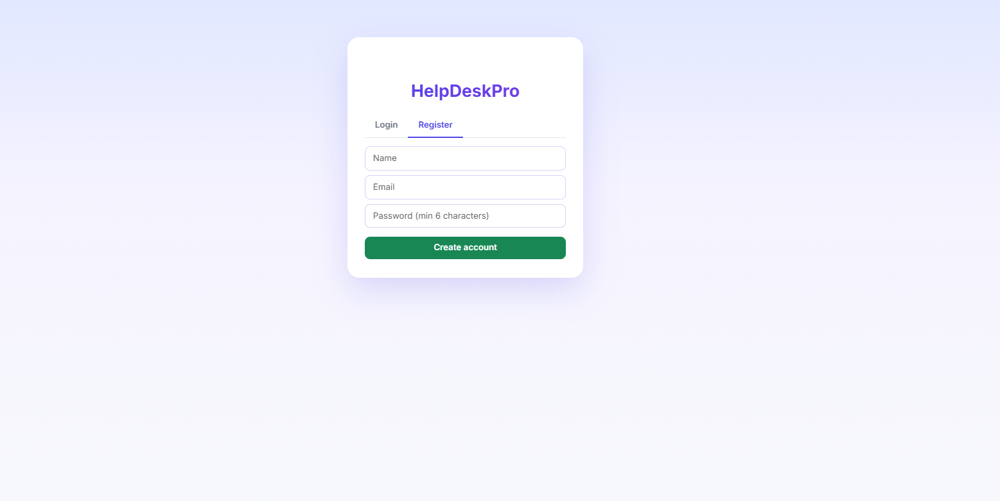
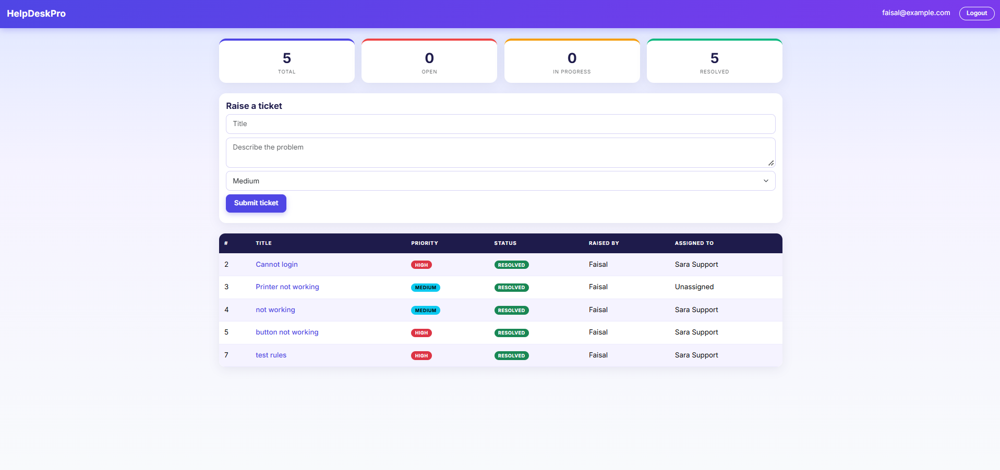
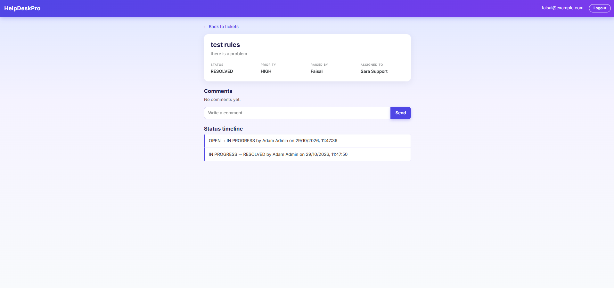
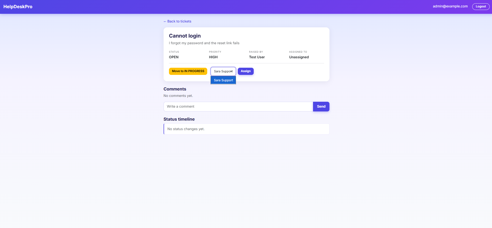
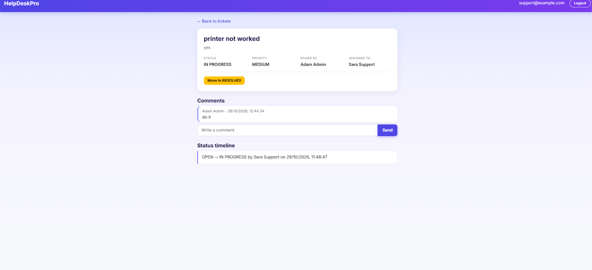
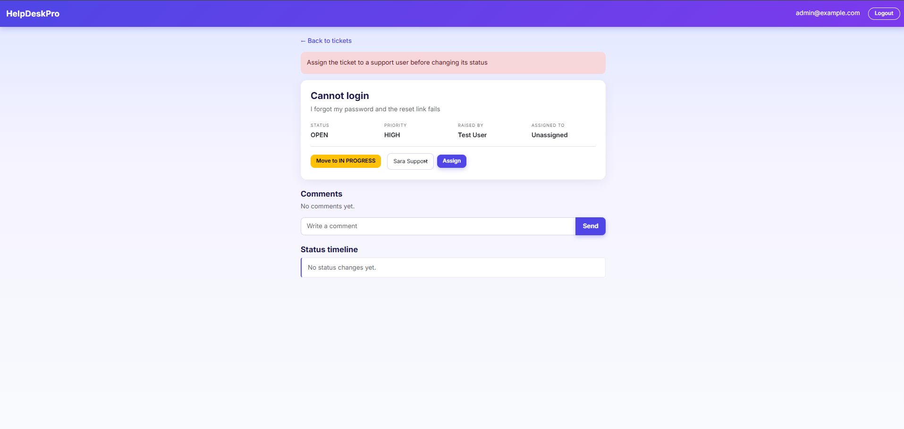

# HelpDeskPro

A role-based support ticket system built with Spring Boot, MySQL, and a plain HTML/CSS/JavaScript frontend. Users raise tickets, an admin assigns them to support staff, and support staff move them through a fixed status flow. Every status change is recorded in a history timeline.

## Screenshots

| Login | User dashboard |
|---|---|
|  |  |

| Ticket detail | Admin actions |
|---|---|
|  |  |

| Support view | Clear error messages |
|---|---|
|  |  |

## Features

- Register and log in, with passwords stored as BCrypt hashes
- Three roles: USER, SUPPORT, ADMIN
- Users raise tickets with a title, description, and priority
- Role-based visibility: users see their own tickets, support sees tickets assigned to them, admins see all
- Admin assigns tickets to support staff
- Fixed status flow: OPEN -> IN_PROGRESS -> RESOLVED, with no skipping and no going back
- A ticket must be assigned before its status can change, and a resolved ticket cannot be reassigned
- Status history timeline showing who changed what and when
- Comments on tickets, limited to the creator, the assignee, and admins
- Dashboard counts by status, scoped to what each role can see
- Input validation with clear error messages

## Tech stack

Java 17, Spring Boot, Spring Security, Spring Data JPA, Hibernate, MySQL, REST APIs, HTML, CSS, JavaScript, Bootstrap 5, Postman for API testing.

## How it works

- **Layers:** Controller -> Service -> Repository -> Database
- **Security:** HTTP Basic authentication checked against users in MySQL; roles are enforced in `SecurityConfig` and again in the service layer
- **Business rules:** the status transition rule lives in the `Status` enum, so every code path uses the same rule
- **Errors:** a global exception handler returns clean JSON messages

## API overview

| Method | Endpoint | Who |
|---|---|---|
| POST | `/api/auth/register` | Anyone |
| GET | `/api/me` | Logged in |
| GET | `/api/tickets` | Logged in (filtered by role) |
| POST | `/api/tickets` | Logged in |
| GET | `/api/tickets/{id}` | Creator, assignee, admin |
| PATCH | `/api/tickets/{id}/assign` | Admin |
| PATCH | `/api/tickets/{id}/status` | Support (own tickets), admin |
| GET / POST | `/api/tickets/{id}/comments` | Creator, assignee, admin |
| GET | `/api/tickets/{id}/history` | Creator, assignee, admin |
| GET | `/api/dashboard` | Logged in (filtered by role) |

## Run locally

1. Install Java 17 and MySQL, and create a database: `CREATE DATABASE helpdeskpro;`
2. Copy `application-example.properties` to `application.properties` and set your MySQL password.
3. Run `./mvnw spring-boot:run` (or `mvnw.cmd spring-boot:run` on Windows).
4. Open `http://localhost:8081`.
5. Register a user. Roles SUPPORT and ADMIN are set in the database:
   `UPDATE users SET role = 'ADMIN' WHERE email = 'you@example.com';`

## Future improvements

- Password reset by email, using a one-time token that expires
- Session cookies or JWT instead of Basic Auth in the browser
- Soft delete or archive for tickets
- Email notifications on assignment and resolution
- Pagination, search, and filters on the ticket list
- Docker and cloud deployment

## Author

Faisalkhan Pathan | [LinkedIn](https://www.linkedin.com/in/faisalkhan-pathan-80a814277) | [GitHub](https://github.com/faisalpathan1210)